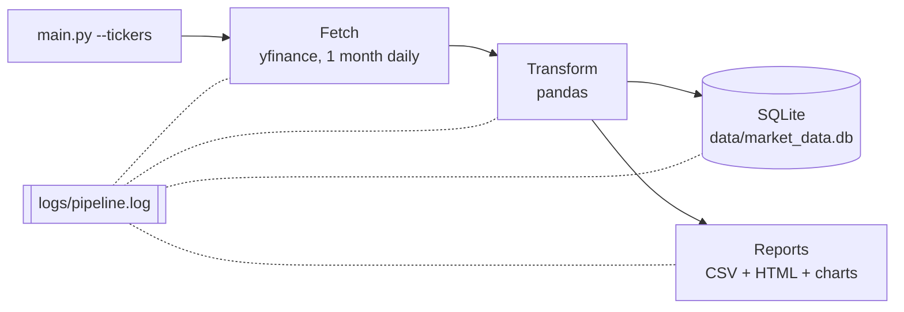

# MarketPulse: High-Level Design

An automated financial data pipeline: fetch daily stock prices, compute returns, moving averages and volatility, store them in SQLite and produce CSV and HTML reports. For code-level detail see the [Low-Level Design](lld.md).

## 1. Pipeline



## 2. Components

| Module | Responsibility |
|---|---|
| `main.py` | CLI, runs the four steps per ticker, skips failed tickers |
| `data_fetcher.py` | Downloads OHLCV with `yf.download(period="1mo", interval="1d", auto_adjust=True)` |
| `transformer.py` | Cleans data, adds daily return, 5-day moving average and volatility |
| `database.py` | Creates the table and inserts rows without duplicates |
| `reporter.py` | CSV export, matplotlib price charts, HTML summary via Jinja2 |
| `config.py` | Tickers, windows, paths; creates `logs/`, `reports/`, `data/` |
| `utils.py` | Logger to file and console |

## 3. Tech

| Item | Choice |
|---|---|
| Language | Python 3 |
| Data | pandas, yfinance |
| Storage | SQLite |
| Reports | matplotlib, Jinja2 |

## 4. Run

```bash
pip install -r requirements.txt
python main.py                      # AAPL GOOGL MSFT AMZN TSLA
python main.py --tickers NVDA META  # custom list
```
