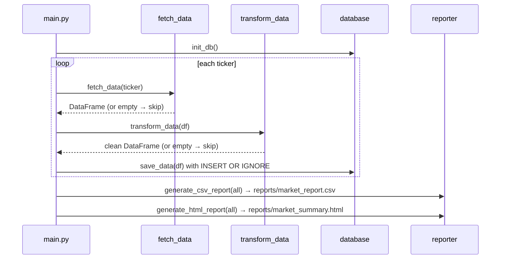

# MarketPulse: Low-Level Design

For the big picture see the [High-Level Design](hld.md).

## 1. Configuration (`config.py`)

| Setting | Value |
|---|---|
| `DEFAULT_TICKERS` | AAPL, GOOGL, MSFT, AMZN, TSLA |
| `MOVING_AVERAGE_WINDOW`, `VOLATILITY_WINDOW` | 5 |
| `DB_PATH` | `data/market_data.db` |
| `REPORTS_DIR`, `LOG_FILE` | `reports/`, `logs/pipeline.log` |
| `DATA_SOURCE`, `ALPHA_VANTAGE_API_KEY` | From environment (default `yfinance`) |

## 2. Transform

| Column | Formula |
|---|---|
| `Daily_Return` | `Close.pct_change() × 100` |
| `MA_5` | 5-day rolling mean of `Close` |
| `Volatility` | 5-day rolling standard deviation of `Close` |

Rows with empty values from the rolling windows are dropped.

## 3. Table

```sql
CREATE TABLE IF NOT EXISTS stock_prices (
  ticker TEXT, date TEXT,
  open REAL, high REAL, low REAL, close REAL, volume INTEGER,
  daily_return REAL, moving_avg_5d REAL, volatility_5d REAL,
  PRIMARY KEY (ticker, date)
);
```

`save_data()` uses `INSERT OR IGNORE`, so re-running the pipeline never duplicates a day.

## 4. Run sequence



## 5. Errors

Each ticker runs inside its own `try`, so one bad symbol is logged and skipped while the rest continue.
